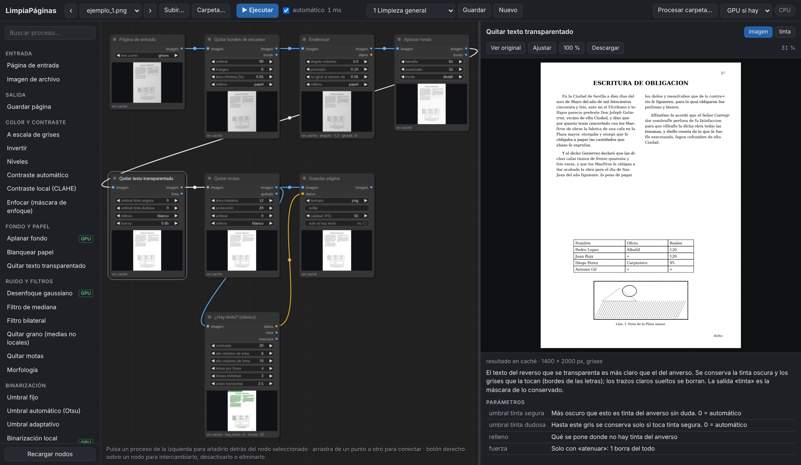

# LimpiaPáginas

*[English version](README.md)*

Limpieza de páginas escaneadas antes del OCR, con un editor visual de flujos.

Cada proceso (binarizar, desenfocar, enderezar, quitar el fondo…) es una caja con sus parámetros. Las cajas se
conectan como un diagrama de flujo, se reordenan, se desactivan o se cambian, y el resultado de cada paso se ve
al momento. Cuando el flujo funciona, se aplica a carpetas enteras.



**[Manual de usuario](docs/MANUAL.md)**: instalación, primer uso paso a paso, recetas para problemas frecuentes y catálogo de procesos, con pantallazos y ejemplos.

## Instalación

Hace falta **Python 3.11 o superior**. El instalador crea un entorno virtual en `.venv`, instala las
dependencias y, si encuentra una GPU NVIDIA, instala PyTorch y ONNX Runtime con CUDA. Al final ejecuta un
diagnóstico que dice qué ha quedado funcionando.

**Windows:** doble clic en `instalar.bat`. Para no instalar la parte de GPU: `instalar.bat -Cpu`.

**Linux:**

```bash
./instalar.sh
```

El instalador se puede repetir sin problema, por ejemplo tras actualizar el controlador de la gráfica.

## Arrancar

**Windows:** doble clic en `iniciar.bat`. **Linux:** `./iniciar.sh`.

Se abre el navegador en `http://127.0.0.1:8765`. El servidor solo escucha en el propio equipo. Para usarlo
desde otro equipo de la red, cambia `host` a `0.0.0.0` en `config.toml`; no tiene contraseña, así que hazlo
solo en una red de confianza.

## La interfaz

- **Izquierda, la paleta.** Todos los procesos, por categorías. Al pulsar uno se añade detrás del nodo
  seleccionado y, si ese nodo ya tenía algo conectado detrás, se inserta en medio.
- **Centro, el diagrama.** Arrastra de un punto de salida a uno de entrada para conectar. Cada nodo enseña una
  miniatura de su resultado, lo que ha tardado y si se ejecutó en la GPU.
- **Derecha, el visor.** Muestra a tamaño completo el resultado del nodo seleccionado. Rueda para ampliar,
  arrastrar para mover, doble clic para ajustar. El zoom se conserva al cambiar parámetros, para afinar mirando
  siempre el mismo detalle. Mantén pulsado **Ver original** (o la tecla `O`) para comparar con la página sin tratar.

Con **automático** marcado, el flujo se vuelve a ejecutar al tocar cualquier parámetro o conexión. Solo se
recalcula desde el nodo que cambió; lo anterior sale de la caché.

Parámetros: las flechas suben y bajan el valor, arrastrar sobre el control lo cambia de forma continua y un
clic permite escribirlo.

Botón derecho sobre un nodo:

| Opción | Qué hace |
| --- | --- |
| Desactivar | El nodo deja pasar la imagen sin tocarla. Sirve para ver qué aporta un paso |
| Intercambiar con el anterior / siguiente | Cambia el orden de dos pasos consecutivos sin rehacer conexiones |
| Duplicar | Copia el nodo con sus parámetros |
| Eliminar y unir sus vecinos | Quita el paso y conecta el anterior con el siguiente |

Atajos: `Ctrl+Intro` ejecutar, `Ctrl+S` guardar el flujo, `Supr` borrar el nodo seleccionado, `F` ajustar la
imagen, `1` verla al 100 %.

Los flujos se guardan como ficheros JSON en `flujos/`. Vienen tres de partida:

1. **Limpieza general**: quita bordes de escaneo, endereza, deja el papel blanco, borra el texto transparentado
   del reverso y las motas, y comprueba si la página tiene texto. Conserva los grises.
2. **Blanco y negro (Sauvola)**: página binarizada, para motores de OCR clásicos.
3. **Detectar texto**: compara los dos detectores de texto sobre la página ya limpia.

## Procesos incluidos

| Categoría | Procesos |
| --- | --- |
| Entrada y salida | Página de entrada, Imagen de archivo, Guardar página |
| Color y contraste | A escala de grises (por canal), Invertir, Niveles, Contraste automático, Contraste local (CLAHE), Enfocar |
| Fondo y papel | Aplanar fondo, Blanquear papel, Quitar texto transparentado |
| Ruido y filtros | Desenfoque gaussiano, Mediana, Bilateral, Quitar grano (medias no locales), Quitar motas, Morfología |
| Binarización | Umbral fijo, Otsu, Adaptativo, Local (Sauvola, Wolf, NICK, Niblack) |
| Geometría | Enderezar, Rotar, Girar 90° / voltear, Quitar bordes de escaneo, Recortar al contenido, Recortar márgenes, Redimensionar |
| Detección de texto | ¿Hay texto? (clásico) |
| Máscaras y mezcla | Aplicar máscara, Combinar imágenes |
| Redes neuronales | Detector de texto (PP-OCR), Modelo ONNX (imagen → imagen) |

Cada proceso explica en el visor qué hace y para qué sirve cada parámetro. `python -m limpiapaginas nodos`
(con el Python de `.venv`) los lista en la consola.

Dos cosas pensadas para impresos antiguos:

- **Quitar motas** no borra las manchas pequeñas que están junto a una letra, porque suelen ser tildes, puntos
  de las íes, comas o diéresis. Su salida «quitado» enseña exactamente qué se ha borrado.
- **Quitar texto transparentado** conserva la tinta oscura y los grises que la tocan, y borra los trazos claros
  sueltos. Donde el reverso se cruza con una letra del anverso puede quedar un resto.

Los detectores de texto deben ir **después** de la limpieza: sobre la página sin tratar toman por texto el
reverso transparentado.

## GPU

Hay tres vías de aceleración, las tres opcionales:

| Vía | Qué acelera | Cómo se instala |
| --- | --- | --- |
| PyTorch + CUDA | Los nodos marcados **GPU** en la paleta: Aplanar fondo, Desenfoque gaussiano, Sauvola | Lo hace el instalador |
| ONNX Runtime + CUDA | El detector de texto y los modelos ONNX propios | Lo hace el instalador |
| OpenCL de OpenCV | Mediana, bilateral, medias no locales y morfología | Viene con el controlador de NVIDIA |

El selector de arriba a la derecha elige **GPU si hay**, **Solo CPU** o **GPU**; el valor inicial está en
`config.toml`. Si la GPU falla en un nodo (por ejemplo, porque otro proceso ocupa toda su memoria), ese nodo se
repite en CPU y el aviso aparece en el visor.

Para comprobar qué está funcionando, con tiempos de CPU y de GPU:

```bash
.venv/bin/python -m limpiapaginas diagnostico
```

En Windows: `.venv\Scripts\python -m limpiapaginas diagnostico`.

Notas:

- El OpenCV que se instala con `pip` no trae CUDA; por eso la GPU se usa a través de PyTorch, ONNX Runtime y
  OpenCL. Compilar OpenCV con CUDA es posible, pero no hace falta para nada de lo incluido.
- La RTX 5090 necesita PyTorch con CUDA 12.8 o posterior. El instalador de Windows prueba varias versiones, de
  la más nueva a la más antigua.
- En filtros clásicos sobre una sola página, la CPU suele ser igual de rápida: OpenCV está muy optimizado y
  subir la imagen a la GPU tiene un coste. La GPU compensa en las redes neuronales y en páginas muy grandes.

## Procesar carpetas

Desde la interfaz, **Procesar carpeta…** aplica el flujo actual a todas las imágenes de una carpeta, con
subcarpetas si se marca. Sin interfaz:

```bash
.venv/bin/python -m limpiapaginas ejecutar "flujos/1 Limpieza general.json" /ruta/entrada /ruta/salida --recursivo
```

En la carpeta de salida quedan:

- las páginas limpias, con la misma estructura de subcarpetas;
- `informe.csv`: una fila por página con el tiempo, el fichero guardado, los errores y los datos de los nodos
  de detección (si hay texto, número de líneas, ángulo corregido…);
- `flujo_usado.json`: copia del flujo aplicado.

La carpeta de salida no puede ser la de entrada. El nodo **Guardar página** tiene la opción «solo si hay
texto»: con su entrada «datos» conectada a un detector, las páginas sin texto no se guardan.

Formatos de entrada: PNG, JPG, TIFF, BMP y WEBP. Los PDF hay que convertirlos antes a imágenes.

## Añadir procesos propios

Deja un fichero `.py` en `nodos_extra/` y pulsa **Recargar nodos**. `nodos_extra/ejemplo.py` es una plantilla
comentada que ya añade un proceso real (quitar tinta de color). Lo mínimo es esto:

```python
from limpiapaginas.registro import IMAGEN, Entero, nodo

@nodo("mios/aclarar", titulo="Aclarar",
      entradas={"imagen": IMAGEN}, salidas={"imagen": IMAGEN},
      params=[Entero("cantidad", 20, 0, 255, ayuda="Cuánto se aclara")])
def aclarar(ctx, imagen, cantidad):
    import cv2
    return cv2.add(imagen, cantidad)
```

La interfaz dibuja la caja, sus conexiones y sus controles a partir de esa declaración; no hay que tocar
JavaScript.

Para usar una red neuronal propia de limpieza (eliminación de ruido, binarización, restauración) sin escribir
código: expórtala a ONNX, déjala en `modelos/` y usa el nodo **Modelo ONNX (imagen → imagen)**, que la aplica
por teselas.

## Estructura

```
limpiapaginas/
  registro.py      decorador @nodo y tipos de parámetro
  motor.py         ejecución del diagrama y caché
  dispositivo.py   detección y uso de la GPU
  lote.py          procesado de carpetas
  servidor.py      API y servidor web local
  nodos/           los procesos, un fichero por categoría
  web/             la interfaz (HTML, CSS y JavaScript, sin compilación)
nodos_extra/       procesos propios
flujos/            flujos guardados
modelos/           modelos ONNX
datos/entrada      páginas de prueba (tres ejemplos sintéticos y tres páginas reales de 1845, 1907 y 1909)
datos/salida       salida por defecto de los lotes
tests/             pruebas
```

## Pruebas

```bash
.venv/bin/python -m pip install -r requirements-dev.txt
.venv/bin/python -m pytest
```

Las rutas de GPU se prueban también sin GPU: se ejecutan con PyTorch en CPU y se comparan con la versión de
OpenCV.

## Licencia

El código de LimpiaPáginas se publica con licencia MIT (ver `LICENSE`).

## Licencias de terceros

- [LiteGraph.js](https://github.com/jagenjo/litegraph.js) (MIT), el editor de diagramas, en `limpiapaginas/web/vendor/`.
- Modelo `PP-OCRv6_det_small.onnx` de [PaddleOCR](https://github.com/PaddlePaddle/PaddleOCR) (Apache 2.0),
  tomado del paquete [RapidOCR](https://github.com/RapidAI/RapidOCR), en `modelos/`. Texto de la licencia en `modelos/LICENSE-PaddleOCR-Apache-2.0.txt`.
