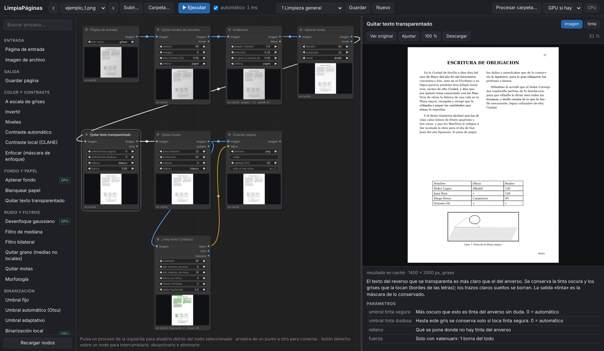

# LimpiaPáginas

*[Versión en español](README.es.md)*

Cleaning scanned pages before OCR, with a visual flow editor.

Every process (deskew, flatten the paper, remove show-through, remove specks, binarise…) is a box with its own parameters. Boxes are connected like a flow chart, reordered, switched off or swapped, and the result of every step is shown as you change it. Once a recipe works on a few pages, it is applied to whole folders.



> The interface and the full user manual are in Spanish. **[Manual de usuario](docs/MANUAL.md)**: installation, a first run step by step, recipes for common problems and the catalogue of processes, with screenshots and examples.

It was built as the first link of the OCR pipeline of a historical archive: [archive-ocr-engine](https://github.com/jachaos/archive-ocr-engine).

## Quick start

You need **Python 3.11 or later** (Windows 10/11 or Linux). An NVIDIA GPU is optional.

```bash
git clone https://github.com/jachaos/limpiapaginas.git
cd limpiapaginas
```

Or download the ZIP from GitHub (**Code → Download ZIP**) and unzip it to a short path such as `C:\limpiapaginas`.

| | Windows | Linux |
|---|---|---|
| Install | double-click `instalar.bat` (`instalar.bat -Cpu` to skip the GPU part) | `./instalar.sh` |
| Start | double-click `iniciar.bat` | `./iniciar.sh` |

The installer creates its own environment in `.venv`, installs the dependencies and, if it finds an NVIDIA card, PyTorch and ONNX Runtime with CUDA. It ends with a diagnosis of what is working, and it can be run again at any time.

**Text detector model (one-off download).** The neural text detector, used by the **3 Detectar texto** recipe, needs PaddleOCR's [PP-OCRv6 small detection model](https://huggingface.co/docs/transformers/model_doc/pp_ocrv6_small_det), which is not included in this repository. Download `inference.onnx` from [PaddlePaddle/PP-OCRv6_small_det_onnx](https://huggingface.co/PaddlePaddle/PP-OCRv6_small_det_onnx/tree/main) on Hugging Face and save it as `modelos/PP-OCRv6_det_small.onnx`, or from the project folder (Linux, or Windows 10/11; in PowerShell type `curl.exe` instead of `curl`):

```bash
curl -L -o modelos/PP-OCRv6_det_small.onnx https://huggingface.co/PaddlePaddle/PP-OCRv6_small_det_onnx/resolve/main/inference.onnx
```

The other processes and recipes work without it.

The app opens in the browser at `http://127.0.0.1:8765` and only listens on your own machine. Pick a page from `datos/entrada` (three synthetic examples and three real pages from 1845, 1907 and 1909), choose the recipe **1 Limpieza general** and click the boxes to see what each step does.

To check the installation, with CPU and GPU timings:

```bash
.venv/bin/python -m limpiapaginas diagnostico        # Windows: .venv\Scripts\python -m limpiapaginas diagnostico
```

## What is in the box

- **36 processes**: input and output, colour and contrast, paper and background, noise and filters, binarisation (Otsu, adaptive, Sauvola, Wolf, NICK, Niblack), geometry, text detection, masks, and neural networks (PP-OCR text detector, any image-to-image ONNX model).
- **Three ready recipes:** *General cleaning* (white paper, text kept in its original greys), *Black and white (Sauvola)* for classic OCR engines, and *Detect text*, which compares a classic and a neural detector on the cleaned page.
- **Live results:** every box shows a thumbnail of its output, its time and whether it ran on the GPU. With *automático* on, only the steps after the change are recomputed.
- **See what a step removed:** several steps have a second output with exactly what they erased (frame, specks) or kept (ink). That is how you check a step is not taking text with it.
- **Batch processing** from the editor or the command line, with a CSV of one row per page (time, file written, angle corrected, lines and letters detected, text or not) and a copy of the recipe used. Originals are never modified.
- **GPU when there is one:** PyTorch and ONNX Runtime with CUDA, OpenCL for some OpenCV filters, and automatic fallback to the CPU if a step fails on the GPU. Black and white on a large page: 341 ms on CPU, 31 ms on an RTX 5070 Ti.

Two details meant for old prints: *Quitar motas* never removes small marks next to a letter (accents, i-dots, commas), and the text detectors should always run **after** cleaning, because on an uncleaned page they take show-through for text.

## Command line

```bash
.venv/bin/python -m limpiapaginas ejecutar "flujos/1 Limpieza general.json" /path/in /path/out --recursivo
.venv/bin/python -m limpiapaginas nodos          # list all processes
```

Input formats: PNG, JPG, TIFF, BMP and WEBP. PDFs are turned into images first with `herramientas/extraer_paginas.py` (see the manual).

## Adding your own processes

Drop a `.py` file in `nodos_extra/` and click **Recargar nodos**. The interface builds the box, its connections and its controls from the declaration; no JavaScript is needed. `nodos_extra/ejemplo.py` is a commented template.

```python
from limpiapaginas.registro import IMAGEN, Entero, nodo

@nodo("mios/aclarar", titulo="Aclarar",
      entradas={"imagen": IMAGEN}, salidas={"imagen": IMAGEN},
      params=[Entero("cantidad", 20, 0, 255, ayuda="How much to lighten")])
def aclarar(ctx, imagen, cantidad):
    import cv2
    return cv2.add(imagen, cantidad)
```

A cleaning network of your own can be used without code: export it to ONNX, put it in `modelos/` and use the **Modelo ONNX (imagen → imagen)** box, which applies it tile by tile.

## Project layout

```
limpiapaginas/     the app: registro.py (@nodo), motor.py (graph and cache), dispositivo.py (GPU),
                   lote.py (batches), servidor.py (local API), nodos/ (processes), web/ (interface, no build step)
nodos_extra/       your own processes
flujos/            saved recipes (JSON)
modelos/           ONNX models
datos/entrada      sample pages
datos/salida       default batch output
herramientas/      PDF page extraction and manual screenshots
docs/              user manual (Spanish) and its images
tests/             automated tests
```

## Tests

```bash
.venv/bin/python -m pip install -r requirements-dev.txt
.venv/bin/python -m pytest
```

GPU code paths are also tested without a GPU: they run with PyTorch on the CPU and are compared with the OpenCV version.

## Safety

The app is meant for local use and has **no users or password**. If you set `host = "0.0.0.0"` in `config.toml` to reach it from another machine, do it only on a trusted network and never expose it to the internet.

## Known limits

- It does not open PDFs directly; extract the pages first.
- The source resolution sets the ceiling: cleaning does not create detail.
- *Quitar texto transparentado* can also remove very faint front-side text (pencil, badly faded ink); check its *tinta* output.
- The recipes are tuned on the sample pages; other collections may need other values.
- The effect on OCR accuracy is measured in the pipeline that uses it ([archive-ocr-engine](https://github.com/jachaos/archive-ocr-engine)), not in this tool.

## Licence

LimpiaPáginas is released under the MIT licence (see `LICENSE`).

Third-party components:

- [LiteGraph.js](https://github.com/jagenjo/litegraph.js) (MIT), the diagram editor, in `limpiapaginas/web/vendor/`.
- The PP-OCRv6 small text detection model from [PaddleOCR](https://github.com/PaddlePaddle/PaddleOCR) (Apache 2.0) is not included; it is downloaded from [Hugging Face](https://huggingface.co/PaddlePaddle/PP-OCRv6_small_det_onnx/tree/main) (see above). Licence text in `modelos/LICENSE-PaddleOCR-Apache-2.0.txt`.

## Author

Javier Chaos · [LinkedIn](https://www.linkedin.com/in/javierchaos/) · [GitHub](https://github.com/jachaos)
