# LimpiaPáginas: manual de usuario

> Manual de usuario de [LimpiaPáginas](../README.md): qué es, cómo se instala y cómo se usa, paso a paso y con ejemplos.

**Contenido**

1. [Qué es LimpiaPáginas](#1-qué-es-limpiapáginas)
2. [Instalación y puesta en marcha](#2-instalación-y-puesta-en-marcha)
3. [La pantalla de un vistazo](#3-la-pantalla-de-un-vistazo)
4. [Primer uso, paso a paso](#4-primer-uso-paso-a-paso)
5. [Las tres recetas que vienen preparadas](#5-las-tres-recetas-que-vienen-preparadas)
6. [Ajustar una receta](#6-ajustar-una-receta)
7. [Procesar una carpeta entera](#7-procesar-una-carpeta-entera)
8. [Catálogo de procesos](#8-catálogo-de-procesos)
9. [Recetas para problemas frecuentes](#9-recetas-para-problemas-frecuentes)
10. [Si algo no funciona](#10-si-algo-no-funciona)
11. [Qué se ha hecho y en qué estado está](#11-qué-se-ha-hecho-y-en-qué-estado-está)

## 1. Qué es LimpiaPáginas

LimpiaPáginas prepara páginas escaneadas para que un programa de reconocimiento de texto (OCR) las lea mejor. Un OCR se equivoca cuando la página viene torcida, con el papel gris o amarillento, con manchas, con el texto del reverso transparentado o con un marco negro alrededor. LimpiaPáginas quita todo eso y deja solo el texto sobre papel blanco.

No hace falta saber programar. La limpieza se arma como un diagrama de cajas: cada caja es un proceso (enderezar, quitar el marco, blanquear el papel…) y las cajas se conectan una detrás de otra. Lo que sale de cada caja se ve al momento, así que se puede ir probando hasta que la página quede bien y después aplicar lo mismo a una carpeta entera.

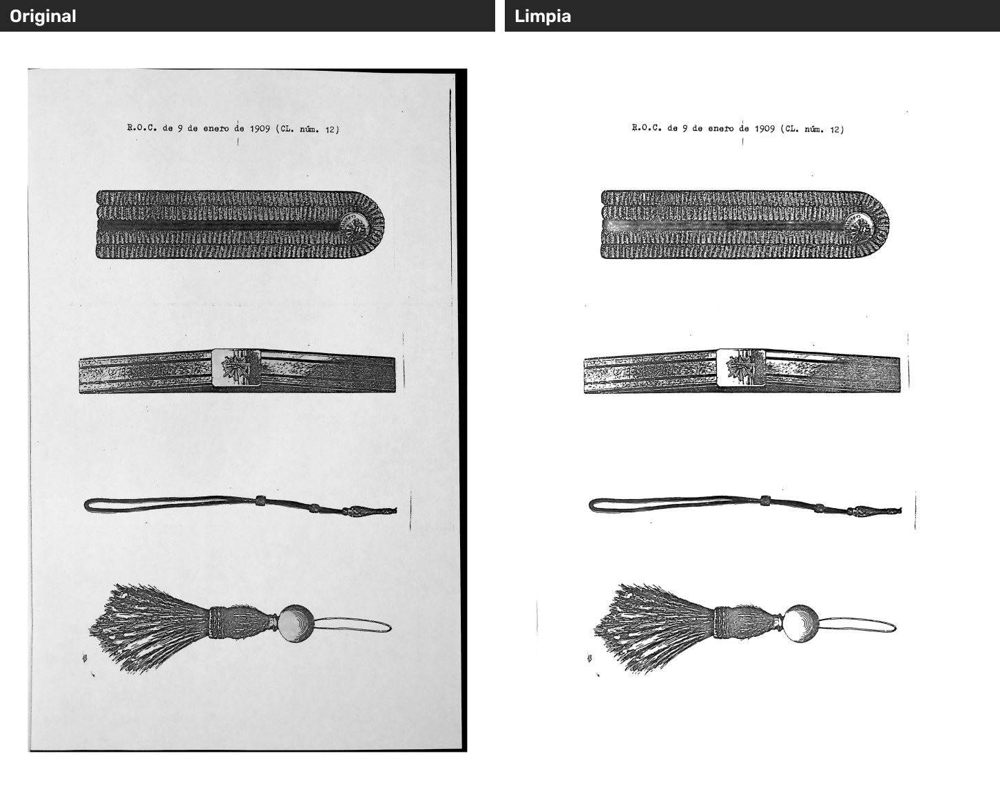

*Figura 1. Una página real antes y después de la limpieza: desaparecen el fondo gris y el marco negro.*

Tres ideas bastan para manejarla:

- **Página**: la imagen escaneada sobre la que se prueba.
- **Flujo**: el diagrama completo, es decir, la receta de limpieza. Se guarda y se reutiliza.
- **Nodo** o **proceso**: cada caja del diagrama, con sus ajustes.

La aplicación funciona en el propio equipo y se maneja desde el navegador. Las páginas no salen del ordenador.

## 2. Instalación y puesta en marcha

LimpiaPáginas se instala y se usa en el propio equipo. No necesita servidor, base de datos ni conexión a internet para trabajar: solo hace falta internet durante la instalación, para descargar las dependencias.

### Requisitos

| Requisito | Detalle |
| --- | --- |
| Sistema | Windows 10 u 11, o Linux |
| Python | **3.11 o superior** ([python.org](https://www.python.org/downloads/)). En Windows, marca «Add Python to PATH» al instalarlo |
| Disco | Unos 6 GB con la parte de GPU, o 1,5 GB solo para CPU |
| Tarjeta gráfica | Opcional. Con una NVIDIA y su controlador al día, los procesos marcados **GPU** van más rápido. Sin ella todo funciona igual |
| Navegador | Cualquiera actual (Edge, Chrome, Firefox) |

### 1. Conseguir el programa

Con Git:

```
git clone https://github.com/jachaos/limpiapaginas.git limpiapaginas
cd limpiapaginas
```

Sin Git, descarga el ZIP desde GitHub (botón **Code**, **Download ZIP**) y descomprímelo en una carpeta, por ejemplo `C:\limpiapaginas`. Conviene una ruta corta y sin permisos especiales (no dentro de «Archivos de programa»).

### 2. Instalar

**Windows:** doble clic en **`instalar.bat`**.

**Linux:**

```
./instalar.sh
```

El instalador hace cuatro cosas:

1. Busca Python 3.11 o superior.
2. Crea un entorno propio en la carpeta `.venv`, sin tocar el Python del sistema.
3. Instala las dependencias y, si encuentra una tarjeta NVIDIA, PyTorch y ONNX Runtime con CUDA. Prueba varias versiones de CUDA, de la más nueva a la más antigua.
4. Ejecuta un diagnóstico que dice qué ha quedado funcionando.

Para instalar solo la parte de CPU aunque haya tarjeta gráfica: `instalar.bat -Cpu`. El instalador se puede repetir sin problema, por ejemplo tras actualizar el controlador de la gráfica.

### 3. Arrancar

**Windows:** doble clic en **`iniciar.bat`**. **Linux:** `./iniciar.sh`.

1. Se abre una ventana negra de consola: es el motor de la aplicación y tiene que quedarse abierta mientras trabajas.
2. Se abre el navegador en `http://127.0.0.1:8765`. Si no se abre solo, escribe esa dirección en el navegador.

Para parar, cierra la ventana negra de consola. La pestaña del navegador deja de responder y se puede cerrar.

### 4. Comprobar la instalación

```
.venv\Scripts\python -m limpiapaginas diagnostico
```

En Linux, `.venv/bin/python` en lugar de `.venv\Scripts\python`. La orden lista qué funciona (OpenCV, PyTorch, ONNX Runtime, la tarjeta gráfica) y compara tiempos en CPU y en GPU.

Para pasar además las pruebas automáticas:

```
.venv\Scripts\python -m pip install -r requirements-dev.txt
.venv\Scripts\python -m pytest
```

### Configuración

Todo está en el fichero `config.toml` de la carpeta del proyecto. Los cambios se aplican al volver a arrancar.

| Ajuste | Para qué sirve | Valor inicial |
| --- | --- | --- |
| `dispositivo` | `auto` usa la GPU si la hay, `cpu` no la usa, `gpu` la exige | `auto` |
| `opencl` | Deja que OpenCV use la gráfica en algunos filtros | `true` |
| `host` y `puerto` | Dónde escucha la aplicación | `127.0.0.1` y `8765` |
| `carpeta_entrada`, `carpeta_salida` | Carpetas por defecto de páginas y resultados | `datos/entrada`, `datos/salida` |
| `carpeta_flujos`, `carpeta_modelos`, `carpeta_nodos_extra` | Dónde se guardan las recetas, los modelos y los procesos propios | `flujos`, `modelos`, `nodos_extra` |
| `cache_mb` | Memoria para recordar resultados intermedios | `1024` |

### Usarla desde otro equipo de la red

Por defecto la aplicación solo atiende al propio equipo. Para abrirla desde otro ordenador de la misma red, cambia `host` a `"0.0.0.0"` en `config.toml`, arranca y entra desde el otro equipo en `http://<nombre o IP del equipo>:8765`. La primera vez, Windows preguntará si permite el acceso en el cortafuegos.

La aplicación está pensada para uso local: **no tiene usuarios ni contraseña**. Cualquiera que llegue a esa dirección puede ver las páginas y lanzar procesos, así que hazlo solo en una red de confianza y nunca la expongas a internet.

### Actualizar

Con Git, `git pull` en la carpeta del proyecto y vuelve a ejecutar `instalar.bat` por si hay dependencias nuevas. Tus recetas (`flujos`), tus páginas (`datos`) y tu `config.toml` no se tocan al instalar.

### Extras opcionales

- **Sacar páginas de PDF** (sección 7) necesita PyMuPDF: `.venv\Scripts\python -m pip install --no-deps pymupdf`. El `--no-deps` importa: sin él se instala una copia de ONNX Runtime para CPU que desactiva la de GPU. Si ya ha pasado, vuelve a ejecutar el instalador.
- **Regenerar los pantallazos de este manual** (`herramientas\capturas_manual.py`) necesita Playwright.

### Dónde está cada cosa

| Carpeta o fichero | Qué contiene |
| --- | --- |
| `instalar.bat`, `iniciar.bat` (`.sh` en Linux) | Instalar y arrancar |
| `config.toml` | La configuración |
| `datos\entrada` | Las páginas que aparecen en la aplicación para probar |
| `datos\salida` | Los resultados cuando se procesa una carpeta |
| `flujos` | Las recetas de limpieza guardadas |
| `modelos` | Los modelos de red neuronal |
| `nodos_extra` | Procesos propios añadidos por el usuario |
| `limpiapaginas` | El código de la aplicación |
| `herramientas` | Utilidades: sacar páginas de PDF, generar el manual |
| `docs` | Este manual y sus imágenes |
| `tests` | Las pruebas automáticas |

## 3. La pantalla de un vistazo

La pantalla tiene cuatro zonas, numeradas en la figura.

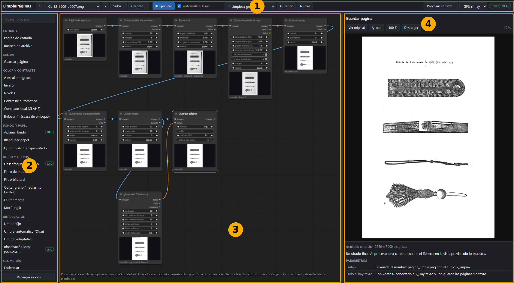

*Figura 2. La pantalla completa con sus cuatro zonas.*

### ① Barra superior

De izquierda a derecha:

| Control | Para qué sirve |
| --- | --- |
| Lista de páginas y flechas ‹ › | Elegir la página de prueba y pasar a la anterior o la siguiente |
| **Subir…** | Añadir imágenes desde cualquier carpeta a la carpeta de entrada |
| **Carpeta…** | Cambiar la carpeta de la que se leen las páginas |
| **▶ Ejecutar** | Aplicar el flujo a la página elegida |
| Casilla **automático** | Con ella marcada, el flujo se vuelve a ejecutar solo cada vez que cambias algo. Al lado aparece lo que ha tardado |
| Lista de flujos | Abrir una receta guardada |
| **Guardar** y **Nuevo** | Guardar la receta actual o empezar una vacía |
| **Procesar carpeta…** | Aplicar la receta a todas las páginas de una carpeta |
| **GPU si hay** | Elegir si se usa la tarjeta gráfica. Lo normal es no tocarlo. La etiqueta verde de al lado dice qué tarjeta se ha detectado |

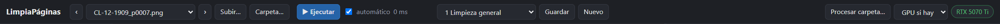

*Figura 3. La barra superior.*

### ② Lista de procesos

A la izquierda están todos los procesos disponibles, agrupados por categorías (Color y contraste, Fondo y papel, Ruido y filtros…). El buscador de arriba filtra por nombre. Al pulsar un proceso se añade al diagrama detrás de la caja que tengas seleccionada. Los que llevan la etiqueta **GPU** se aceleran con la tarjeta gráfica.

### ③ Diagrama

En el centro está la receta. Cada caja muestra:

- su nombre arriba;
- sus ajustes, que se cambian ahí mismo;
- una miniatura de cómo queda la página al salir de esa caja;
- debajo, lo que ha tardado y si se ha ejecutado en la GPU.

Las líneas azules llevan la imagen de una caja a la siguiente. Las líneas amarillas llevan datos, por ejemplo el resultado de «¿Hay texto?». Para moverte por el diagrama arrastra el fondo; para acercar o alejar usa la rueda del ratón.

### ④ Visor

A la derecha se ve a tamaño grande el resultado de la caja seleccionada. Debajo de la imagen aparecen los datos que ha calculado esa caja, una explicación de lo que hace y la descripción de cada uno de sus ajustes: es la ayuda integrada de la aplicación.

| Botón | Para qué sirve |
| --- | --- |
| **Ver original** | Mientras lo mantienes pulsado se ve la página sin tratar. Es la forma más rápida de comparar. También con la tecla `O` |
| **Ajustar** | Encaja la página entera en el panel. Tecla `F` |
| **100 %** | Tamaño real, para mirar el detalle de las letras. Tecla `1` |
| **Descargar** | Guarda la imagen que estás viendo |

Con la rueda del ratón se amplía y arrastrando se mueve la imagen. El zoom se conserva al cambiar un ajuste, así que puedes afinar mirando siempre el mismo detalle. Si la caja tiene varias salidas, arriba a la derecha aparecen pestañas para elegir cuál ver.

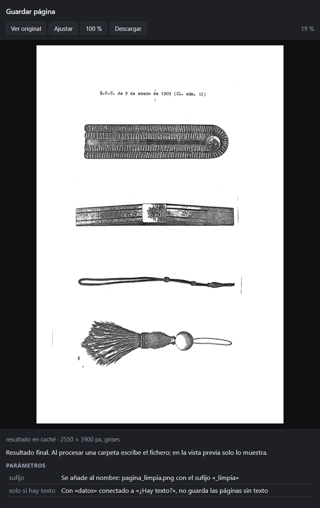

*Figura 4. El visor con el resultado, los datos y la ayuda del proceso seleccionado.*

## 4. Primer uso, paso a paso

Este recorrido limpia una página con la receta que ya viene preparada. Se tarda dos minutos.

1. **Arranca la aplicación** con `iniciar.bat` (sección 2).
2. **Elige una página** en la lista de arriba a la izquierda, por ejemplo `CL-12-1909_p0007.png`. Con las flechas ‹ › pasas de una a otra.
3. **Elige el flujo** «1 Limpieza general» en la lista de flujos. Aparece el diagrama con sus cajas.
4. **Espera un instante.** Con la casilla «automático» marcada el flujo se ejecuta solo. Si no lo está, pulsa **▶ Ejecutar**. Cada caja se llena con su miniatura.
5. **Pulsa la caja «Guardar página»**, que es la última. El visor de la derecha enseña el resultado final.
6. **Compara con el original** manteniendo pulsado **Ver original**. Al soltar vuelve la página limpia.
7. **Mira el detalle** con **100 %** y arrastra hasta una zona con letra pequeña. Las letras tienen que seguir enteras, con sus tildes y sus puntos.
8. **Recorre los pasos.** Pulsa las demás cajas, de la primera a la última, para ver qué hace cada una.

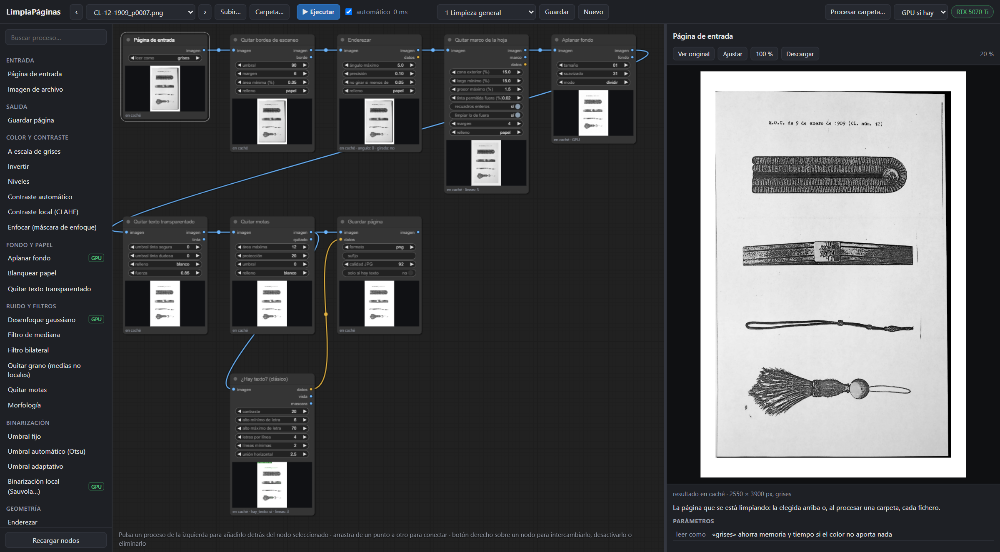

*Figura 5. La página tal como entra: pulsando la primera caja se ve el original, con el papel gris y el marco negro.*

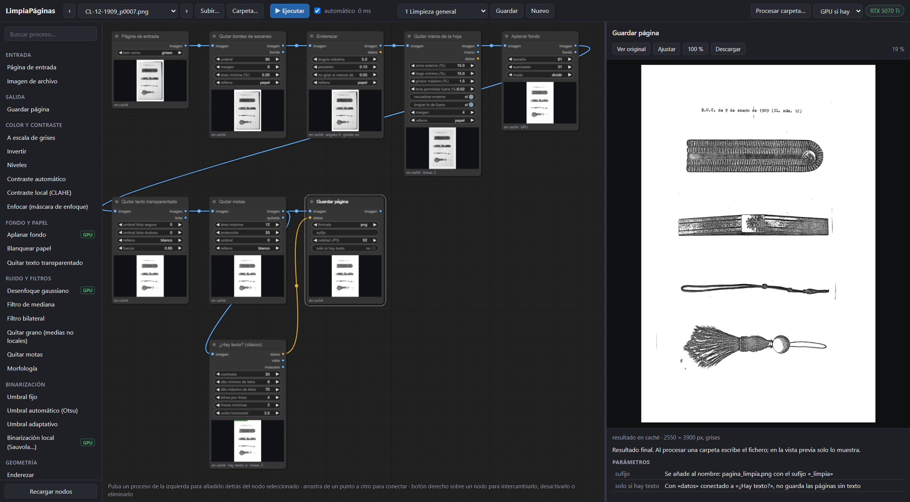

*Figura 6. La misma página al final del flujo, con la caja «Guardar página» seleccionada.*

En la vista previa no se escribe nada en el disco: solo se enseña el resultado. Los ficheros se guardan cuando se procesa una carpeta (sección 7) o con el botón **Descargar** del visor.

Para probar con tus propias páginas, pulsa **Subir…** y elige las imágenes, o cópialas a `datos\entrada`. Se admiten PNG, JPG, TIFF, BMP y WEBP. Para páginas que están dentro de un PDF, mira la sección 7.

## 5. Las tres recetas que vienen preparadas

La aplicación trae tres flujos listos para usar. Sirven tal cual y también como punto de partida para hacer los tuyos.

| Flujo | Qué entrega | Cuándo usarlo |
| --- | --- | --- |
| **1 Limpieza general** | La página con el papel blanco y el texto en sus grises originales | La opción por defecto. Conserva el matiz de las letras, que es lo que mejor leen los OCR modernos y los modelos de IA |
| **2 Blanco y negro (Sauvola)** | La página en blanco y negro puro, sin grises | Para motores de OCR clásicos, o cuando el texto está muy pálido y hay que reforzarlo |
| **3 Detectar texto** | No guarda nada: dice si la página tiene texto y dónde | Para comprobar la detección y para separar páginas en blanco, láminas y portadas |

### 1 Limpieza general

Los pasos, en orden:

1. **Página de entrada** lee la imagen en escala de grises.
2. **Quitar bordes de escaneo** borra las bandas negras pegadas al borde de la imagen (el lomo del libro, el borde del escáner).
3. **Enderezar** corrige la inclinación de la página.
4. **Quitar marco de la hoja** borra las líneas rectas largas que rodean la página y los recuadros.
5. **Aplanar fondo** iguala la iluminación y deja el papel blanco.
6. **Quitar texto transparentado** borra lo que se caló del reverso de la hoja.
7. **Quitar motas** elimina las manchas pequeñas sueltas.
8. **¿Hay texto?** cuenta renglones y letras, y anota si la página tiene texto.
9. **Guardar página** es el resultado final.

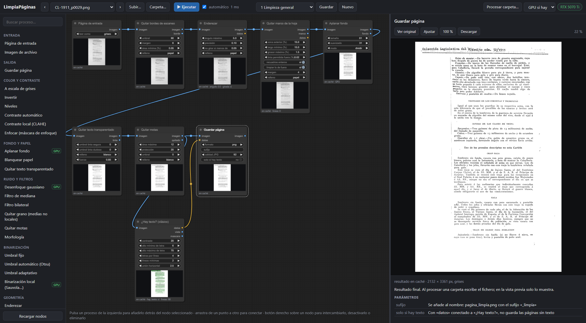

*Figura 7. «Limpieza general» sobre una página de texto.*

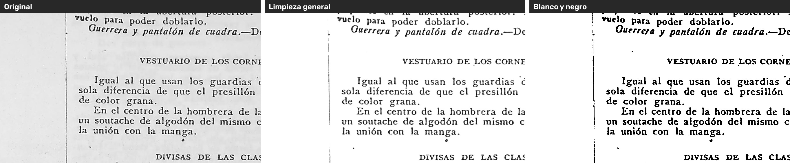

*Figura 8. Detalle a tamaño real: el original, la limpieza general y el blanco y negro.*

### 2 Blanco y negro (Sauvola)

Endereza, quita el marco, aplana el fondo, suaviza un poco y después decide píxel a píxel si es tinta o papel con el método de Sauvola, que se adapta a cada zona de la página. Termina quitando las motas.

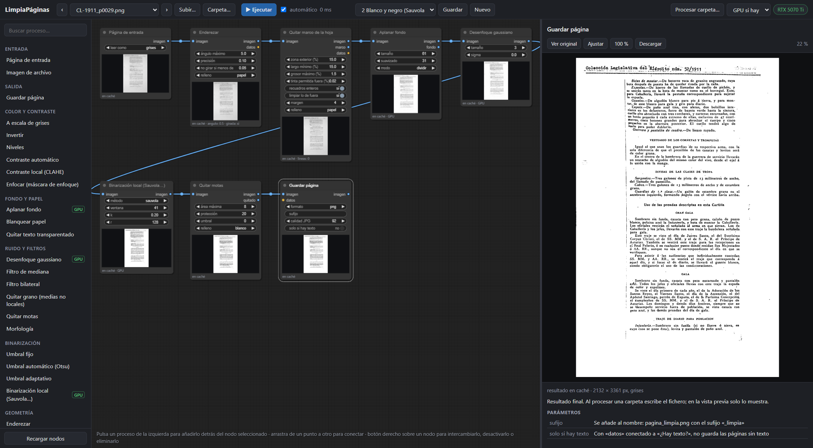

*Figura 9. «Blanco y negro» sobre la misma página.*

### 3 Detectar texto

Limpia el fondo y pasa la página por dos detectores para poder compararlos: el **clásico**, que busca formas del tamaño de una letra alineadas en renglones, y el de **red neuronal**, más robusto con fondos sucios y que distingue mejor el texto de los grabados. La salida «vista» de cada uno dibuja en verde los renglones encontrados.

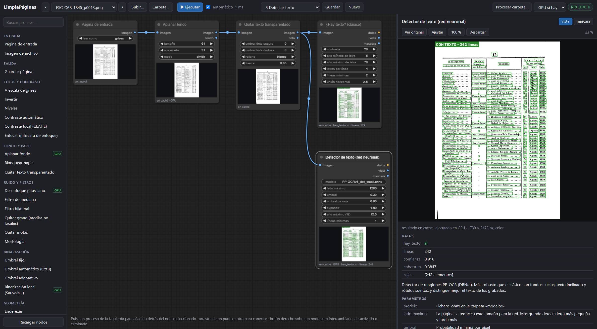

*Figura 10. El detector de red neuronal marca cada renglón de una tabla.*

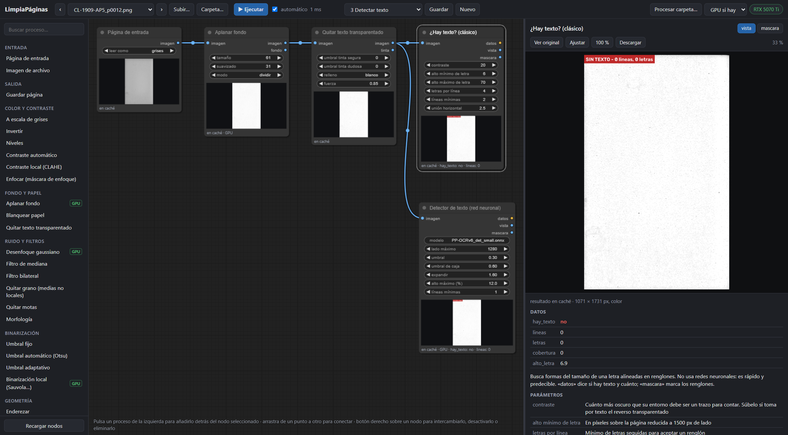

*Figura 11. Una página en blanco: el detector responde «sin texto».*

Los detectores van siempre **después** de la limpieza. Sobre la página sin tratar pueden tomar por texto lo que se transparenta del reverso.

## 6. Ajustar una receta

Cuando una página no queda bien con la receta preparada, se ajusta. La forma de trabajar es siempre la misma: tocar una cosa, mirar el visor y decidir.

### Cambiar un ajuste

Cada caja tiene sus ajustes en forma de renglones con un nombre y un valor.

- Las **flechas** ◀ ▶ de cada renglón bajan y suben el valor.
- **Arrastrar** sobre el renglón lo cambia de forma continua.
- Un **clic** sobre el valor permite escribirlo.
- Los ajustes de **sí / no** se cambian con un clic.

Para saber qué hace un ajuste, selecciona la caja y lee el apartado «Parámetros» debajo del visor: cada ajuste está explicado ahí. Si te pierdes, el menú del botón derecho tiene «Restaurar valores por defecto».

### Ver qué aporta un paso

Pulsa con el **botón derecho** sobre una caja y elige **Desactivar**. La caja deja pasar la imagen sin tocarla y se ve cómo quedaría la página sin ese paso. Con el mismo menú se vuelve a activar.

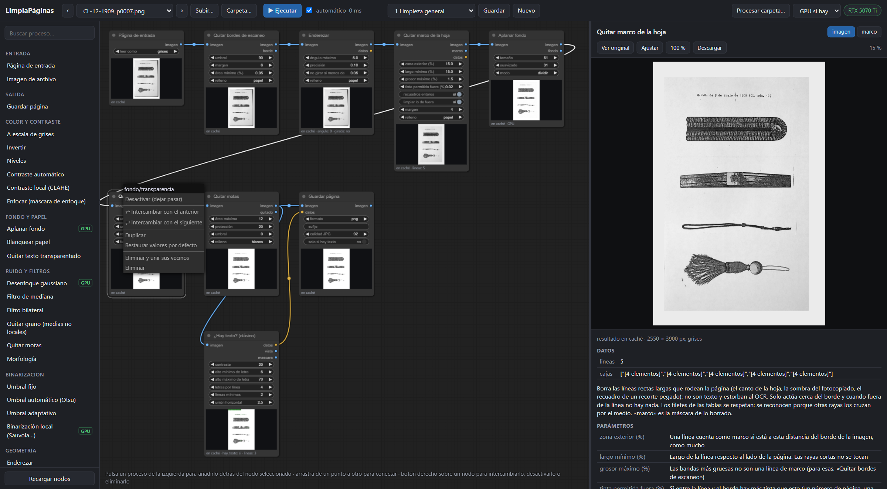

*Figura 12. El menú del botón derecho sobre una caja.*

| Opción del menú | Qué hace |
| --- | --- |
| Desactivar (dejar pasar) | La caja no actúa. Sirve para comparar con y sin ese paso |
| Intercambiar con el anterior o el siguiente | Cambia el orden de dos pasos sin rehacer las conexiones |
| Duplicar | Copia la caja con sus ajustes |
| Restaurar valores por defecto | Devuelve los ajustes a como venían |
| Eliminar y unir sus vecinos | Quita el paso y conecta el anterior con el siguiente |
| Eliminar | Quita la caja y deja el hueco |

### Ver qué ha borrado un paso

Varios procesos tienen una segunda salida que enseña exactamente lo que han quitado: «marco» en *Quitar marco de la hoja*, «quitado» en *Quitar motas* y, al revés, la tinta que se conserva en *Quitar texto transparentado*, «borde» en *Quitar bordes de escaneo*. Selecciona la caja y pulsa la pestaña con ese nombre arriba a la derecha del visor. Lo blanco es lo borrado. Es la mejor comprobación de que un paso no se está llevando texto.

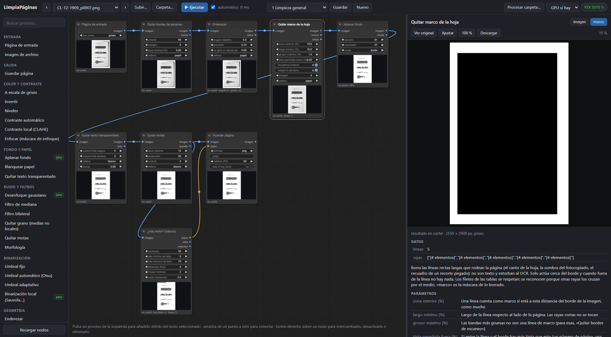

*Figura 13. La salida «marco»: en blanco, lo que el proceso ha borrado de la página.*

### Añadir un paso

1. Selecciona la caja detrás de la cual quieres el paso nuevo.
2. Pulsa el proceso en la lista de la izquierda.

La caja nueva se coloca detrás y, si la seleccionada ya tenía algo conectado, se inserta en medio. Para conectar a mano, arrastra desde un punto de salida (a la derecha de una caja) hasta un punto de entrada (a la izquierda de otra).

### Guardar la receta

Pulsa **Guardar** y escribe un nombre. Si usas un nombre nuevo, las tres recetas de partida quedan intactas. La receta aparece desde entonces en la lista de flujos y se guarda como un fichero en la carpeta `flujos`.

### Atajos de teclado

| Tecla | Acción |
| --- | --- |
| `Ctrl` + `Intro` | Ejecutar el flujo |
| `Ctrl` + `S` | Guardar el flujo |
| `Supr` | Borrar la caja seleccionada |
| `O` (mantener) | Ver el original |
| `F` | Ajustar la imagen al panel |
| `1` | Ver la imagen al 100 % |

## 7. Procesar una carpeta entera

Cuando la receta funciona con unas cuantas páginas de prueba, se aplica a todas de una vez.

1. Abre el flujo que quieres aplicar.
2. Pulsa **Procesar carpeta…** arriba a la derecha.
3. Escribe la **carpeta de entrada** (donde están las páginas) y la **carpeta de salida** (donde se guardarán limpias). No pueden ser la misma: la aplicación se niega a escribir encima de los originales.
4. Marca **incluir subcarpetas** si las páginas están repartidas en carpetas. La salida conserva la misma estructura.
5. Pulsa **Empezar**. Una barra indica el avance y los errores, si los hay.

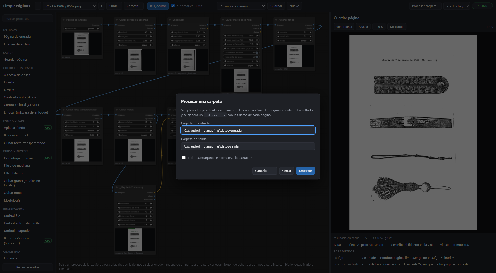

*Figura 14. La ventana «Procesar una carpeta».*

Los originales no se modifican nunca. En la carpeta de salida quedan:

- las **páginas limpias**, con el mismo nombre que las originales;
- **`informe.csv`**, una tabla con una fila por página que se abre con Excel;
- **`flujo_usado.json`**, una copia de la receta aplicada, para saber más adelante cómo se hizo.

### Leer el informe

| Columna | Qué indica |
| --- | --- |
| fichero | La página original |
| estado | `ok` si todo fue bien, o `error` |
| ms | Lo que tardó, en milisegundos |
| guardado | El fichero escrito, o el aviso de que se omitió por no tener texto |
| error | El motivo, si falló |
| Enderezar.angulo | Los grados que se corrigieron |
| Quitar marco de la hoja.lineas | Cuántas líneas de marco se borraron |
| ¿Hay texto?.hay_texto | Si la página tiene texto |
| ¿Hay texto?.lineas y .letras | Cuántos renglones y letras se contaron |

Ordenar el informe por la columna «hay_texto» o por «letras» es una forma rápida de localizar páginas en blanco, portadas y láminas. Una página de texto con muy pocas letras contadas merece una revisión a ojo.

### Saltarse las páginas sin texto

La caja **Guardar página** tiene el ajuste «solo si hay texto». Con él activado, y con su entrada «datos» conectada a un detector de texto (en «Limpieza general» ya lo está), las páginas en blanco no se guardan.

### Páginas que están en un PDF

La aplicación trabaja con imágenes, no abre PDF directamente. Para sacar páginas de los PDF hay una herramienta aparte. Abre una consola en la carpeta del proyecto y ejecuta:

```
.venv\Scripts\python herramientas\extraer_paginas.py muestras datos\entrada --por-pdf 4
```

Necesita PyMuPDF, que se instala aparte (sección 2, «Extras opcionales»). Esa orden saca cuatro páginas repartidas de cada PDF de la carpeta `muestras` (créala y deja ahí tus PDF; el repositorio no los incluye) y las deja en `datos\entrada`. El número se cambia con `--por-pdf`. Si la página es un escaneo, se extrae la imagen original sin perder calidad.

### Sin abrir la aplicación

Un lote también se puede lanzar desde la consola, útil para dejarlo trabajando:

```
.venv\Scripts\python -m limpiapaginas ejecutar "flujos\1 Limpieza general.json" C:\ruta\entrada C:\ruta\salida --recursivo
```

Como referencia, con una tarjeta RTX 5070 Ti «Limpieza general» procesó 61 páginas en 17 segundos y «Blanco y negro» en 11.

## 8. Catálogo de procesos

Hay 36 procesos. No hace falta conocerlos todos: con los que usan las recetas preparadas se resuelve casi todo. Esta lista sirve para saber qué hay cuando haga falta algo más.

### Entrada y salida

| Proceso | Qué hace |
| --- | --- |
| Página de entrada | Es la página que se limpia. Todo flujo empieza aquí |
| Imagen de archivo | Una imagen fija que no cambia de una página a otra, por ejemplo una máscara |
| Guardar página | El resultado final. Todo flujo termina aquí |

### Geometría

| Proceso | Qué hace |
| --- | --- |
| Enderezar | Mide la inclinación de los renglones y gira la página hasta dejarlos horizontales |
| Quitar bordes de escaneo | Borra las bandas negras pegadas al borde de la imagen |
| Quitar marco de la hoja | Borra las líneas largas que rodean la página y los recuadros, sin tocar las tablas |
| Recortar al contenido | Recorta la página a la zona que tiene tinta |
| Recortar márgenes (%) | Quita un porcentaje fijo de cada lado |
| Rotar | Gira un ángulo fijo |
| Girar 90° / voltear | Giros exactos, para páginas tumbadas |
| Redimensionar | Amplía o reduce. Ampliar letra pequeña antes de pasar a blanco y negro suele ayudar al OCR |

### Fondo y papel

| Proceso | Qué hace |
| --- | --- |
| Aplanar fondo | Quita sombras, degradados y el tono amarillento. El papel queda blanco y la tinta conserva sus grises |
| Blanquear papel | Mide el gris del papel y lo lleva a blanco. Más simple que el anterior |
| Quitar texto transparentado | Borra el texto del reverso que se cala, que es más claro que el del anverso |

### Ruido y filtros

| Proceso | Qué hace |
| --- | --- |
| Quitar motas | Borra manchas pequeñas y aisladas. Respeta las que están junto a una letra, que suelen ser tildes, puntos y comas |
| Desenfoque gaussiano | Suaviza el grano fino. Un poco antes de pasar a blanco y negro evita letras con bordes rotos |
| Filtro de mediana | Quita puntos sueltos. Con tamaños grandes se come los puntos de las íes |
| Filtro bilateral | Alisa el papel respetando los bordes de las letras |
| Quitar grano | El mejor contra el grano del papel, pero lento en páginas grandes |
| Morfología | Engorda o adelgaza los trazos. «Cerrar» repara letras rotas |

### Color y contraste

| Proceso | Qué hace |
| --- | --- |
| A escala de grises | Convierte una página en color a grises |
| Niveles | Fija el negro, el blanco y el tono medio, como en un editor de fotos |
| Contraste automático | Estira el contraste de toda la página |
| Contraste local (CLAHE) | Realza por zonas la tinta desvaída |
| Enfocar | Afila los bordes de las letras |
| Invertir | Negativo: lo claro pasa a oscuro |

### Binarización (pasar a blanco y negro)

| Proceso | Qué hace |
| --- | --- |
| Binarización local (Sauvola…) | Decide por zonas. Es la que mejor funciona con papel manchado y tinta desigual |
| Umbral automático (Otsu) | Busca un único corte para toda la página. Va bien después de aplanar el fondo |
| Umbral adaptativo | Un corte distinto en cada zona. Aguanta sombras, pero puede sacar ruido en zonas vacías |
| Umbral fijo | Todo lo más oscuro que un valor pasa a negro. Solo sirve con fondo ya uniforme |

### Detección de texto y redes neuronales

| Proceso | Qué hace |
| --- | --- |
| ¿Hay texto? (clásico) | Dice si hay texto, cuántos renglones y cuántas letras. Rápido y predecible |
| Detector de texto (red neuronal) | Localiza los renglones con una red neuronal. Más robusto con fondos sucios |
| Modelo ONNX | Pasa la página por una red de limpieza propia. Uso avanzado |

### Máscaras y otros

| Proceso | Qué hace |
| --- | --- |
| Aplicar máscara | Conserva la imagen solo donde la máscara es blanca. Con la máscara de «¿Hay texto?» borra todo lo que no es texto |
| Combinar imágenes | Une dos ramas del flujo |
| Quitar tinta de color | Borra sellos, subrayados y anotaciones en rojo, azul o violeta. Necesita la página en color |

## 9. Recetas para problemas frecuentes

Cada caso dice qué se ve, qué proceso lo arregla y qué ajuste tocar si no basta. Todos parten de «1 Limpieza general».

### La página tiene un marco o líneas negras alrededor

Son el canto de la hoja, la sombra de una fotocopia o el recuadro de un recorte pegado. Lo arregla **Quitar marco de la hoja**, que ya está en las recetas.

- Si queda algún trozo de línea, baja **largo mínimo** (por ejemplo de 15 a 8).
- Si la línea está más adentro de la página, sube **zona exterior**.
- Si no quieres que borre el recuadro que enmarca un dibujo, desactiva **recuadros enteros**.
- Las tablas no se tocan: el proceso las reconoce porque otras rayas las cruzan por el medio.

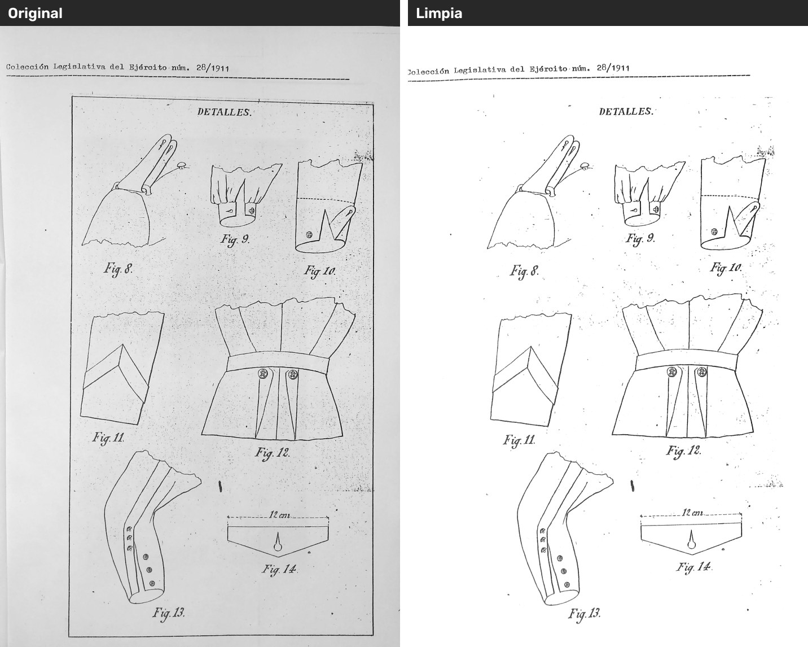

*Figura 15. Un recuadro alrededor de unos dibujos, antes y después.*

### Hay una banda negra pegada al borde

Es el lomo del libro o el borde del escáner. Lo arregla **Quitar bordes de escaneo**. Si la banda es gris y no negra, sube **umbral**.

### La página está torcida

Lo arregla **Enderezar**. Corrige hasta 5 grados; si la página está más inclinada, sube **ángulo máximo**. Si está tumbada o boca abajo, añade antes **Girar 90° / voltear**.

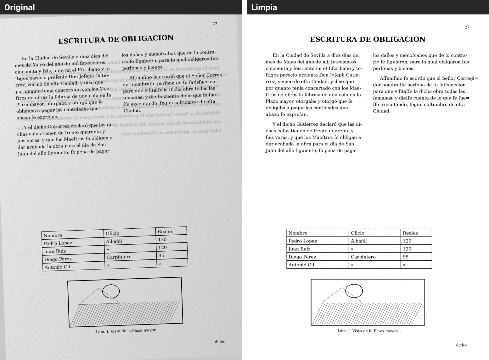

*Figura 16. Una página torcida y con el papel oscuro, antes y después.*

### El papel sale gris, amarillento o con sombras

Lo arregla **Aplanar fondo**. Si quedan sombras amplias, sube **tamaño**. Si se aclaran demasiado los títulos gruesos o los grabados, sube también **tamaño**, porque el proceso los está confundiendo con el fondo.

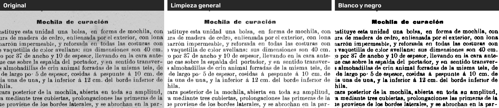

*Figura 17. Detalle de una página con el papel gris: original, limpieza general y blanco y negro.*

### Se transparenta el texto del reverso

Lo arregla **Quitar texto transparentado**. Si aún se ve el reverso, sube **umbral tinta dudosa** poco a poco. Si empieza a borrar letras finas del anverso, bájalo. Comprueba el resultado en la salida «tinta», que enseña lo que se conserva.

### Quedan puntitos y manchas sueltas

Lo arregla **Quitar motas**. Para manchas más grandes sube **área máxima**. Vigila siempre la salida «quitado»: si ahí aparecen tildes, puntos de las íes o comas, el valor es demasiado alto, o hay que subir **protección**.

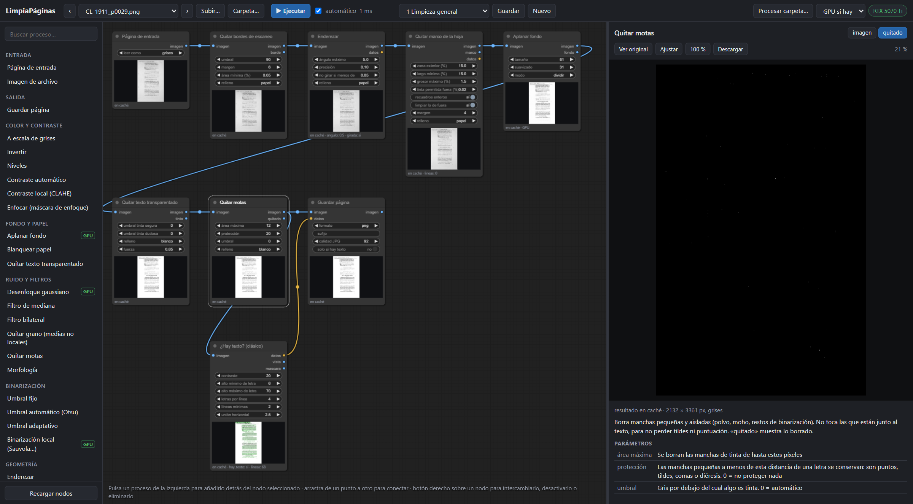

*Figura 18. La salida «quitado» de Quitar motas: cada punto blanco es una mota borrada.*

### Las letras salen rotas o muy finas en blanco y negro

En la caja **Binarización local**, baja **k** (por ejemplo de 0,20 a 0,12) para que recoja más tinta. Si aparece ruido en las zonas vacías, súbelo. Con letra muy pequeña, añade antes **Redimensionar** al doble.

### El texto está muy pálido

Añade **Contraste local (CLAHE)** después de «Aplanar fondo», o usa la receta «2 Blanco y negro».

### Hay sellos o anotaciones en tinta de color

Cambia **leer como** a «color» en la caja «Página de entrada» y añade **Quitar tinta de color** justo detrás. Solo funciona si el escaneo está en color.

### Hay páginas en blanco mezcladas

Activa **solo si hay texto** en «Guardar página» y no se guardarán. En el `informe.csv` quedan anotadas como omitidas.

### Una regla general

El orden importa: primero la geometría (bordes, enderezar, marco), después el fondo, después el ruido y al final, si hace falta, el blanco y negro. Y menos es más: cada paso que se añade puede llevarse algo de texto, así que conviene añadir solo lo que la página necesita.

## 10. Si algo no funciona

| Qué pasa | Qué hacer |
| --- | --- |
| El navegador dice que no puede conectar | La aplicación no está arrancada. Ejecuta `iniciar.bat` y deja abierta la ventana negra |
| `iniciar.bat` dice «Ejecuta primero instalar.bat» | Falta la instalación. Ejecuta `instalar.bat` |
| La ventana negra muestra un error al arrancar | Suele haber otra copia ya abierta usando el mismo puerto. Cierra las demás ventanas negras y vuelve a arrancar |
| No aparece ninguna página en la lista | La carpeta de entrada está vacía. Pulsa **Subir…** o revisa la carpeta con **Carpeta…** |
| Una caja no muestra miniatura | Selecciónala: el visor enseña el motivo. Lo más frecuente es que le falte conectar la entrada |
| He cambiado algo y no se actualiza | Marca la casilla **automático** o pulsa **▶ Ejecutar** |
| El resultado sale todo blanco | Algún paso está borrando de más. Pulsa las cajas una a una, de izquierda a derecha, hasta dar con la primera en la que desaparece el texto, y revísala |
| Va lento | Comprueba que arriba a la derecha aparece el nombre de la tarjeta gráfica en verde. Los procesos «Quitar grano» y «Filtro bilateral» son lentos por naturaleza |
| He estropeado una receta | Usa «Restaurar valores por defecto» en el menú de cada caja, o vuelve a abrir el flujo sin guardar |

### Comprobar la tarjeta gráfica

La etiqueta de arriba a la derecha muestra la tarjeta detectada. Para una comprobación completa, abre una consola en la carpeta del proyecto y ejecuta:

```
.venv\Scripts\python -m limpiapaginas diagnostico
```

La orden lista qué funciona y compara tiempos en CPU y en GPU. Con una RTX 5070 Ti, sobre una página grande, el blanco y negro tarda 341 ms en CPU y 31 ms en GPU.

Si la tarjeta falla en un proceso, por ejemplo porque otro programa ocupa toda su memoria, ese proceso se repite en CPU y el aviso aparece en el visor. El trabajo no se interrumpe.

### Preguntas frecuentes

**¿Se modifican mis originales?** No. La aplicación solo lee la carpeta de entrada y escribe en la de salida.

**¿Salen mis páginas del ordenador?** No. Todo se ejecuta en el equipo y la aplicación solo atiende al propio ordenador.

**¿Hace el OCR?** No. Deja las páginas preparadas para que el OCR las lea mejor. La detección de texto solo dice si hay texto y dónde, no lo lee.

**¿Puedo usar una receta distinta para cada libro?** Sí. Guarda cada una con su nombre y ábrela cuando toque.

## 11. Qué se ha hecho y en qué estado está

Este apartado resume cómo se construyó y se comprobó la aplicación, para quien quiera saber qué hay detrás.

### El proyecto

LimpiaPáginas es el primer eslabón de una cadena de OCR con varios modelos de IA: limpia las páginas antes de que los modelos las lean. Está escrito en Python con OpenCV y usa la tarjeta gráfica cuando la hay.

| Pieza | Qué es |
| --- | --- |
| Motor | Ejecuta el diagrama caja a caja y recuerda los resultados para no repetir cálculos |
| 36 procesos | Las cajas: color, fondo, ruido, binarización, geometría, detección de texto y redes neuronales |
| Interfaz | El editor visual que se abre en el navegador |
| Lotes | El procesado de carpetas enteras con su informe |
| Aceleración | PyTorch y ONNX Runtime sobre la GPU, con vuelta automática a la CPU si algo falla |

### Lo que se hizo

1. **Construcción.** Se escribieron el motor, los procesos, la interfaz y las pruebas.
2. **Instalación en un equipo con Windows y una RTX 5070 Ti.** Hubo que emparejar las versiones: PyTorch 2.14 para CUDA 13, que es la que pide ONNX Runtime GPU 1.32.
3. **Prueba con páginas reales.** Se sacaron 58 páginas de 15 PDF de muestra (escalafones y colecciones legislativas de 1815 a 1916) y se pasaron por los flujos.
4. **Corrección de un fallo grave.** «Quitar texto transparentado» dejaba en blanco las páginas escaneadas en blanco y negro puro. Afectaba a 9 de las 58. Está corregido y tiene su prueba.
5. **Proceso nuevo: «Quitar marco de la hoja».** Borra los marcos negros y recuadros que estorban al OCR sin tocar las tablas. Está incluido en las recetas 1 y 2.
6. **Revisión externa del código** con un segundo modelo de IA (DeepSeek). Cada hallazgo se reprodujo antes de corregirlo. Lo corregido:
   - «Quitar marco de la hoja» podía llevarse un número de página suelto situado entre la raya y el borde. Ahora lo que tiene tamaño de letra o de cifra no se borra nunca.
   - «Quitar bordes de escaneo» dejaba en blanco las páginas de papel muy oscuro o en negativo. Ahora compara con el tono del papel y, si el «borde» ocuparía casi toda la página, no borra nada y avisa.
   - «Quitar motas» podía borrar una página entera de letra diminuta. Ahora lo detecta, no borra y avisa.
   - «Enderezar» giraba 5,5 grados las páginas en blanco. Ahora las deja como están.
   - Los escaneos de 10, 12 o 14 bits guardados en ficheros de 16 se leían casi negros. Ahora se detecta la profundidad real.
   - El procesado por carpetas desde la consola podía escribir encima de los originales si la salida era la misma carpeta. Ahora se rechaza siempre, y dos páginas con el mismo nombre y distinta extensión ya no se pisan (`a_png.png`, `a_jpg.png`).
   - «Subir…» sustituía una página si ya había otra con el mismo nombre. Ahora la guarda como `nombre (2)`.
7. **Este manual**, con pantallazos tomados de la aplicación en marcha.

### Cómo se ha comprobado

- **99 pruebas automáticas** pasan y 1 se omite.
- Las **61 páginas** de prueba (las 58 reales y 3 ejemplos sintéticos) se procesan sin errores con las dos recetas de limpieza.
- Para confirmar que no se pierde texto se cuenta el número de letras detectadas en el conjunto de páginas tras cada cambio: 71.098 antes de añadir el proceso del marco, 71.101 después y 71.087 tras la revisión, es decir, lo mismo con un margen del 0,02 %.
- La única página que sale «sin texto» es una que está en blanco de verdad.

### Límites conocidos

- **No abre PDF directamente.** Hay que sacar antes las páginas con la herramienta de la sección 7.
- **La resolución de origen manda.** Varios PDF traen las páginas a baja resolución (el Anuario de 1916, a unos 750 × 1.200 píxeles). La limpieza no inventa detalle: en esos casos el OCR estará limitado por el escaneo.
- **Rayas cortas sueltas.** «Quitar marco de la hoja» deja las líneas más cortas que el 15 % del lado de la página. Se ajusta con «largo mínimo».
- **Las recetas son un punto de partida.** Están afinadas con estas muestras. Otros fondos documentales pueden pedir otros valores.
- **«Quitar texto transparentado» también borra texto muy tenue del anverso.** Distingue el reverso por ser más claro que la tinta, así que una palabra a lápiz o muy desvaída puede desaparecer. Compruébalo en la salida «tinta» y, si pasa, baja «umbral tinta dudosa» o desactiva el paso.
- **Las portadas y páginas con un solo renglón pueden contar como «sin texto».** «¿Hay texto?» pide al menos dos renglones. Tenlo en cuenta antes de activar «solo si hay texto».
- **Los TIFF de varias páginas** se leen solo por la primera.
- **No se ha medido todavía la mejora en el OCR.** Está comprobado que las páginas quedan más limpias y que no se pierde texto, pero falta comparar el acierto del OCR antes y después.

### Para quien quiera ampliarla

Se pueden añadir procesos propios sin tocar la interfaz: basta dejar un fichero de Python en la carpeta `nodos_extra` y pulsar **Recargar nodos**. El fichero `nodos_extra\ejemplo.py` es una plantilla comentada. Los detalles técnicos están en el `README.md` del proyecto.
